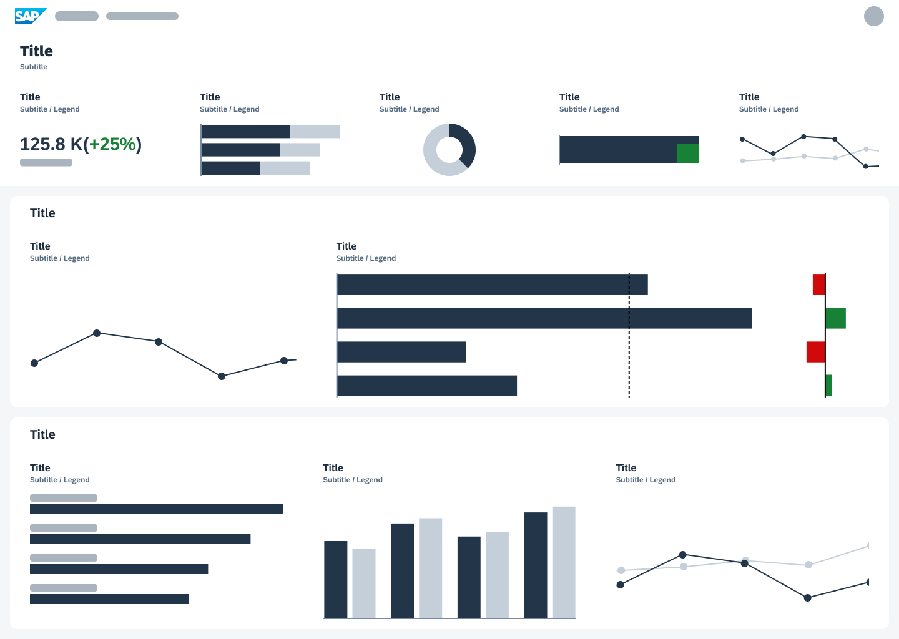
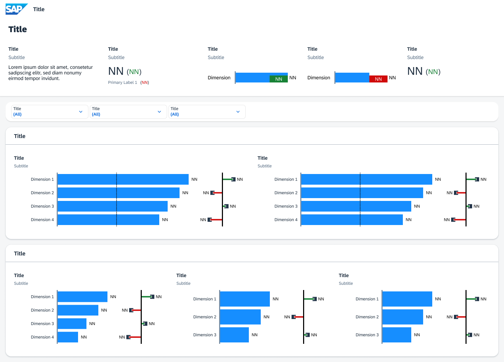

# Fiori Morning Horizon Theme

## Content Package Files
SAP_CC_SAC_Fiori_Horizon_Template (3.0.0).package  
SAP_CC_SAC_Fiori_Morning_Horizon_Theme (2.0.0).package  
SAC_Dashboard_Schematics_UI_Kit.fig  
SAC_Dashboard_Hi-Fi_UI_Kit.fig 

## Last Released:
2026.10

## What´s New
SAP_CC_SAC_Fiori_Horizon_Template (3.0.0).package

## Descripton
This content package includes the Fiori Morning Horizon sample theme, along with a related sample story, two story templates and Figma design files. 

## Details
The content packages includes:
* SAP_CC_SAC_Fiori_Horizon_Template (3.0.0).package including
	* Template: Horizon template
    * Page Header: Composite
The template contained in this package connects to the new default Theme delivered in SAP Analytics Cloud Stories.

* SAP_CC_SAC_Fiori_Morning_Horizon_Theme (2.0.0).package including
	* Theme: Fiori Evening Horizon
	* Theme: Fiori Morning Horizon
	* Template: Horizon template
    * Page Header: Composite
The template contained in this package connects to the Themes contained in this package.

* Figma Design File "Schematics UI KIT" (please also check [www.figma.com](https://www.figma.com))

* Figma Design File "Hi-Fi UI KIT"

## Connectivity
The sample story is based on the Best Run Juice sample data model (already available in all SAP Analytics Cloud tenants).

## Download/Install Instructions
Please check the documentation [here](https://help.sap.com/docs/SAP_ANALYTICS_CLOUD/42093f14b43c485fbe3adbbe81eff6c8/ef516563b3fe4c69b6f718f17ed94cdf.html).
In case you have downloaded on older version of the content, please delete the old content first or move it to a different folder before importing the attached content package. 

## More Information
For more details, please refer to our blog [here](https://community.sap.com/t5/technology-blogs-by-sap/horizon-theme-and-templates-for-stories-in-sap-analytics-cloud/ba-p/13657027).

## Contact
N/A

